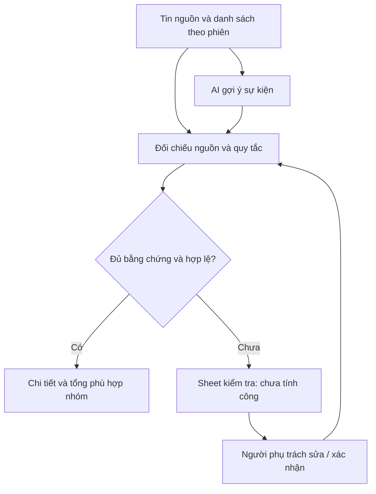

# 02. Dùng AI để đọc linh hoạt, dùng bằng chứng để quyết định

[Trước](01-TU_CONG_VIEC_DEN_THIET_KE.md) · [Mục lục](README.md) · [Tiếp: Excel](03-EXCEL_LA_GIAO_DIEN_BAN_GIAO.md)

## Tình huống: một câu có nhiều người, AI có thể điền quá nhiều

“Minh Quân và Đức Quân OT 2h” cần hai sự kiện, mỗi người 120 phút. Nếu AI chia đôi thời lượng, thay người được báo bằng người gửi hoặc tự bổ sung họ tên không có căn cứ, một bảng tổng trông hợp lý vẫn có thể sai.

AttendSift AI giữ kết quả gợi ý và tin nguồn để đối chiếu. `source_reconciliation.py` trích các tuyên bố rõ, `personnel_policy.py` so tên với danh sách và `validation.py` kiểm tra kiểu dữ liệu, ngày, số phút, nguồn và quan hệ OT/nghỉ bù. Lớp điều phối lưu kết quả theo phiên.

## Nhận diện nhân sự khác với độ tin cậy của sự kiện

Một tên khớp danh sách chính thức vẫn có thể đi kèm tin ghi CTV hoặc tài khoản gửi mâu thuẫn. Giữ phân loại theo danh sách nhưng chuyển **sự kiện** sang kiểm tra giúp không biến một mâu thuẫn nguồn thành kết luận về quan hệ lao động.

Ngược lại, tên “Quân” khớp hai người thì chưa chọn được nhân viên. Tài khoản của người báo hộ không giải quyết mơ hồ cho cả nhóm. Tên ngoài danh sách được xếp CTV theo quy tắc sản phẩm, nên chất lượng danh sách là một điều kiện vận hành quan trọng.

## Quy tắc nhỏ cần bằng chứng cụ thể

Tin tự báo về sớm 30 phút không làm bù, có ngày và người đủ căn cứ, được ghi 30 phút có lương theo quy tắc đã cấu hình. Bộ demo báo ngày 14 và 16 chỉ tạo 2 sự kiện. Không tạo ngày 15, không suy đoán sức khỏe và không áp dụng cho đi trễ hoặc về sớm 45 phút.

Đọc chi tiết tại [chính sách nghỉ 30 phút có lương](../CHINH_SACH_NGHI_30_PHUT_CO_LUONG.md). Tài liệu mô tả quy tắc ứng dụng, không đưa ra tư vấn pháp lý hoặc khẳng định mọi đơn vị phải dùng quy tắc này.

## Đánh đổi cần được giữ nhìn thấy

| Lựa chọn | Được gì | Còn mất gì? |
|---|---|---|
| AI đọc câu tự do | Chịu được nhiều cách viết hơn biểu mẫu cứng | Có thể nhầm; cần đối chiếu và giới hạn API |
| Trích xuất xác định từ nguồn | Kiểm tra được một số cấu trúc rõ ràng | Không bao phủ mọi ngôn ngữ, mọi cách viết |
| Cách ly dòng chưa rõ | Tránh cộng công thiếu căn cứ | Người phụ trách có thêm việc rà soát |
| Cho xác nhận thủ công | Xử lý trường hợp vượt bộ quy tắc | Cần quyền, căn cứ và dấu vết sửa |

Một lớp không xóa hết nhược điểm của lớp khác. Nguồn thiếu thì cả AI lẫn quy tắc đều không tạo được bằng chứng đã mất. Mức confidence cao không được dùng để bỏ qua lỗi bắt buộc.

## Tham khảo và cách áp dụng

Pierre Pureur và Kurt Bittner trong [bài InfoQ ngày 12/02/2026](https://www.infoq.com/articles/ai-generated-mvp/) đề nghị đánh giá các quyết định liên quan AI bằng thử nghiệm và yêu cầu chất lượng rõ ràng. Áp dụng ở đây: viết fixture kiểm tra sự kiện, nguồn và workbook thay vì mô tả mô hình AI là bảo đảm đúng.

Bài nói về kiến trúc phần mềm được tạo với AI; không chứng minh thuật toán nhận diện chấm công của dự án. Phần pipeline và ví dụ trong bài này được suy ra từ mã AttendSift AI.

Điểm giữ lại: **kết quả phải có đường kiểm tra ngược về nguồn, kể cả khi mô hình trả lời tự tin**.
