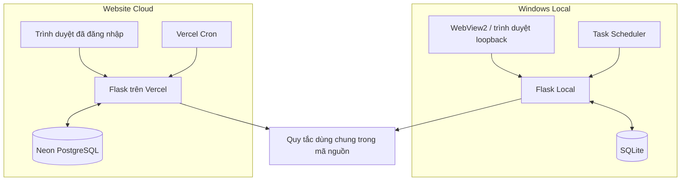

# 04. Windows và Cloud: chung quy tắc, khác trách nhiệm vận hành

[Trước](03-EXCEL_LA_GIAO_DIEN_BAN_GIAO.md) · [Mục lục](README.md) · [Tiếp: đánh đổi](05-LUA_CHON_VA_DANH_DOI.md)

## Tình huống: cùng giao diện web không có nghĩa cùng dữ liệu

Ảnh có thanh tiêu đề `ChamCongChatwork` là ứng dụng Windows hiển thị giao diện web qua WebView2. Website Cloud mở trong trình duyệt, có xác thực quản trị và database riêng. Hai nơi có thể trông tương tự nhưng không tự chia sẻ danh sách, tin nhắn hoặc khóa.

Khối quy tắc trong hình là phần mã được dùng lại trong hai gói triển khai, **không phải một dịch vụ mạng dùng chung**. Không có đường đồng bộ database giữa hai vùng.

## So sánh theo việc phải chịu trách nhiệm

| Quyết định | Local có lợi gì? | Cloud có lợi gì? | Phần cần quản lý |
|---|---|---|---|
| Truy cập | Chạy theo máy được bàn giao | Mở bằng trình duyệt nơi được phép | Local cần quyền máy; Cloud cần tài khoản và cấu hình host |
| Dữ liệu | SQLite cạnh ứng dụng, dễ xác định nơi lưu | PostgreSQL tập trung cho nơi triển khai | Sao lưu, quyền truy cập và thời hạn lưu |
| Lịch | Task Scheduler phù hợp máy người dùng | Cron phù hợp nơi hosting | Máy Local phải bật; Cloud phụ thuộc lịch và quota hosting |
| Cập nhật | Bàn giao EXE theo phiên bản | Cập nhật deployment | Cập nhật một nơi không tự cập nhật nơi kia |
| Phân tích | Quy tắc xử lý ngay trên máy | Quy tắc xử lý trong backend | Cả hai vẫn có thể gửi nội dung tới AI được chọn |

## Giữ chung phần nào?

`personnel_policy.py`, `source_reconciliation.py`, `validation.py` và các mô-đun Excel mô tả quy tắc chung. `src/app/server.py` cùng `export_service.py` điều phối Local; `cloud/app.py` và `cloud/repository.py` xử lý Cloud. Bộ kiểm thử HTTP/fixture cho cả hai giúp phát hiện khác biệt sau thay đổi.

Chi phí là vẫn có hai bộ điều phối và hai lớp lưu trữ. Không tuyên bố chia sẻ quy tắc đã loại bỏ hoàn toàn khả năng lệch. Lỗi “đã xuất rồi không được rà soát” là ví dụ phải sửa và kiểm tra ở cả hai môi trường.

## Khi nào chọn chế độ nào?

Chọn Local khi quy trình bàn giao theo máy phù hợp và có người quản lý sao lưu, phiên bản EXE, lịch Windows. Chọn Cloud khi cần truy cập qua trình duyệt và có khả năng vận hành secrets, database và hosting. Đây là hướng dẫn theo cấu trúc mã hiện có, chưa phải khuyến nghị chi phí dựa trên đo tải.

Cloud áp dụng chính sách dữ liệu nghiệp vụ 3 tháng theo [hướng dẫn retention](../RETENTION_3_MONTHS.md); danh sách nhân viên được giữ. Tải báo cáo cần lưu lâu dài trước hạn. Local không mặc định kế thừa cơ chế xóa Cloud.

## Ý tưởng tham khảo và giới hạn áp dụng

[C4 Container diagram](https://c4model.com/diagrams/container) tách ứng dụng và kho dữ liệu để chỉ rõ trách nhiệm. Sơ đồ bài này theo cách nhìn đó; sơ đồ container không thay thế cấu hình triển khai thật, đo tải hoặc phân tích an toàn hệ thống.

Điểm giữ lại: **mô tả riêng nơi lưu, nơi chạy lịch và cách cập nhật**, kể cả khi giao diện giống nhau.
