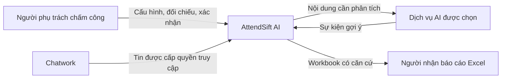
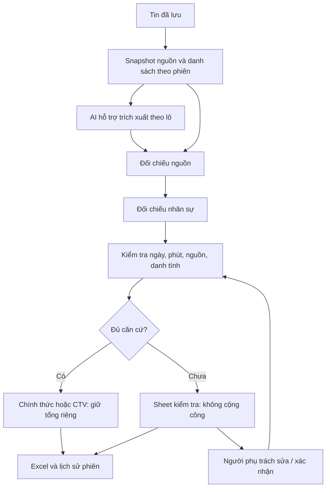

# Kiến trúc AttendSift AI: từ người dùng đến mô-đun

[Về README](../README.md) · [Nguồn và đánh đổi](ARCHITECTURE_REVIEW_1.1.0.md) · [Loạt bài](articles/README.md)

## 1. Mục tiêu mà kiến trúc phải phục vụ

Người phụ trách cần trả lời: ai, ngày nào, bao nhiêu phút, thuộc nhóm nào và tin nào là căn cứ. Vì vậy thiết kế tách **nguồn**, **sự kiện suy ra**, **căn cứ nhân sự**, **quyết định xác nhận** và **báo cáo**. Con số tổng có đường truy ngược; dòng chưa rõ vẫn nhìn thấy nhưng chưa được tính công.


## 2. Ngữ cảnh: ai trao đổi với ai?



Theo cách nhìn [C4 System Context](https://c4model.com/diagrams/system-context), hình đầu tập trung người và các hệ thống liên quan. Chatwork/AI là phụ thuộc bên ngoài; ứng dụng không kiểm soát đầy đủ lịch sử, hạn mức hoặc thời gian phản hồi của chúng.

## 3. Hai môi trường triển khai

| Trách nhiệm | Windows Local | Website Cloud |
|---|---|---|
| Hiển thị | WebView2 hoặc trình duyệt loopback | Trình duyệt có đăng nhập quản trị |
| Điều phối | `src/app/server.py`, `export_service.py` | `cloud/app.py` |
| Lưu trữ | SQLite tại máy | PostgreSQL qua `cloud/repository.py` |
| Danh sách | Registry trong settings, snapshot theo phiên | Registry trong settings Cloud, snapshot JSONB |
| Lịch | Windows Task Scheduler | Vercel Cron |
| Báo cáo | Downloads và bản lưu phiên | File theo phiên trong database |

Hai môi trường dùng lại mã quy tắc, không gọi một dịch vụ quy tắc tập trung. Không tự đồng bộ database, khóa hoặc danh sách giữa Local và Cloud. [Sơ đồ ứng dụng/kho dữ liệu và cách chọn](articles/04-WINDOWS_VA_CLOUD.md).

## 4. Đường đi của một kết quả



Ngày gửi không thay ngày sự kiện. Tin ngoài tháng có thể là ngữ cảnh nhưng không cộng vào tháng xuất. Tin chỉ xin nghỉ/phép năm được giữ ở nguồn theo quy tắc hiện tại. Nghỉ 30 phút có lương cần tin tự báo đủ căn cứ và ghi phút riêng, không tăng thiếu giờ hoặc OT.

## 5. Bản đồ mã nguồn theo trách nhiệm

```text
main.py                       Khởi động ứng dụng Windows
src/app/                      HTTP Local, đường dẫn và vòng đời desktop
src/adapters/                 Kết nối Chatwork và nhà cung cấp AI
src/models/                   SQLite, phiên và dữ liệu hoạt động
src/services/
  employee_registry.py        Quản lý danh sách và revision
  source_reconciliation.py    Đối chiếu từng tuyên bố nguồn
  personnel_policy.py         Căn cứ tên, nhóm nhân sự và thời lượng
  paid_break_policy.py        Quy tắc nghỉ 30 phút có lương
  validation.py               Điều kiện hợp lệ không giao cho AI quyết định
  export_service.py           Điều phối và xuất theo phiên Local
src/utils/                    Workbook, công thức, khóa và bảo vệ dữ liệu
src/scheduler/                Lịch Windows
cloud/                        HTTP, xác thực, PostgreSQL và retention Cloud
templates/ + static/          Giao diện Local và mẫu workbook
public/static/                Tài nguyên phục vụ triển khai web
tests/                        Tình huống giả lập và kiểm tra hồi quy
docs/                         Hướng dẫn, giải thích và bằng chứng theo ngày
```

Các mô-đun vẫn có lời gọi trực tiếp và phần điều phối trùng trách nhiệm giữa hai môi trường. Thiết kế hiện có là ứng dụng chia mô-đun trong một gói cho mỗi chế độ, chưa phải “clean architecture” hoặc modular monolith được cưỡng chế hoàn toàn bằng dependency rules.

## 6. Ranh giới cần giữ

| Dữ liệu/quyết định | Ai quyết định? | Điều không được suy ra |
|---|---|---|
| Nội dung tin | Nguồn đã lưu | Không dùng AI để thay bằng chứng gốc |
| Danh sách chính thức | Người quản trị và snapshot phiên | Không gán cả nhóm theo tài khoản người báo hộ |
| Sự kiện đủ căn cứ | Đối chiếu và kiểm tra | Confidence cao không miễn lỗi bắt buộc |
| Trường hợp chưa rõ | Người phụ trách xác nhận có căn cứ | Không đoán để đủ dòng báo cáo |
| Tổng chính thức/CTV | Mã xuất theo nhóm và trạng thái hợp lệ | Không cộng CTV hoặc dòng lỗi vào tổng chính thức |
| Tiền lương thực tế | Quy trình ngoài phạm vi dự án | Không suy từ số phút thành kết luận trả lương |

## 7. Lưu phiên, phục hồi và kiểm tra sau khi xuất

Local lưu nguồn và danh sách trong phiên; checkpoint giúp tiếp tục tác vụ phân tích gián đoạn. Báo cáo có bản lưu riêng theo phiên và hash file. Cloud lưu trạng thái qua repository và khóa tác vụ bằng lease. Đây là cơ chế phục hồi có trong mã, không phải bảo đảm không thể mất dữ liệu.

Sau khi xuất, người phụ trách có thể mở lại phiên để sửa/xác nhận, rồi xuất lại. Dòng chưa xác minh chỉ nằm ở sheet kiểm tra. Dữ liệu được kiểm tra lại trước khi ghi workbook; file đã tải trước đó không tự đổi theo trạng thái phiên mới.

## 8. Bảo vệ và giới hạn

Local giới hạn host loopback và dùng CSRF cho thay đổi; Cloud có xác thực quản trị, kiểm tra host/origin/CSRF và mã hóa khóa kết nối. Nội dung nguồn ghi dạng text trong Excel. Khóa, danh sách riêng và database không thuộc gói công khai. Các lớp này cần cấu hình đúng, không được diễn giải là bảo mật tuyệt đối.

Snapshot tăng khả năng giải thích nhưng tăng lưu trữ. Danh sách trong settings đơn giản nhưng hạn chế cập nhật đồng thời. Hai lớp điều phối thuận môi trường nhưng có thể lệch; kiểm thử cả hai giảm nhược điểm đó. [Bảng đánh đổi và điều kiện xem xét lại](articles/05-LUA_CHON_VA_DANH_DOI.md).

## 9. Hướng phát triển khi có bằng chứng cần đổi

Cân nhắc bảng nhân viên quan hệ khi cần truy vấn/phân quyền/cập nhật đồng thời phức tạp. Cân nhắc hàng đợi phân tích khi số liệu thời gian hoặc lỗi request chứng minh cần tách tác vụ. Chỉ tách dịch vụ khi có nhu cầu triển khai, mở rộng hoặc quyền sở hữu độc lập rõ ràng. Đây là hướng phát triển, chưa phải tính năng đã triển khai.

[Kết quả kiểm tra hiện tại](UPDATE_2026-10-16.md) phân biệt kiểm thử giả lập với API thật, PostgreSQL staging, WebView2 và Microsoft Excel/WPS còn cần nghiệm thu.
