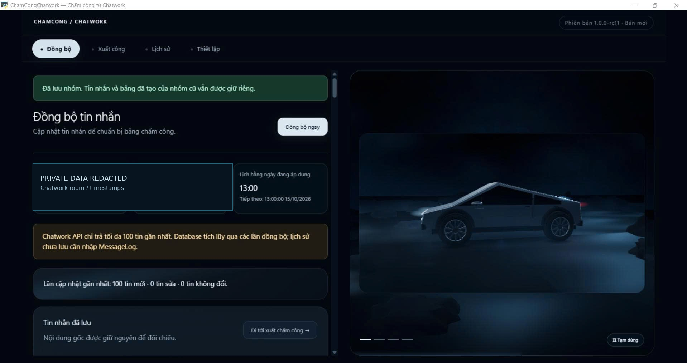
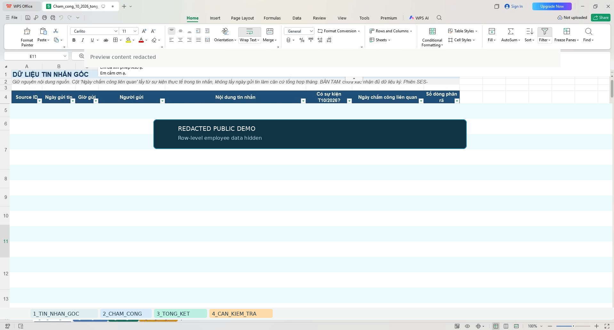
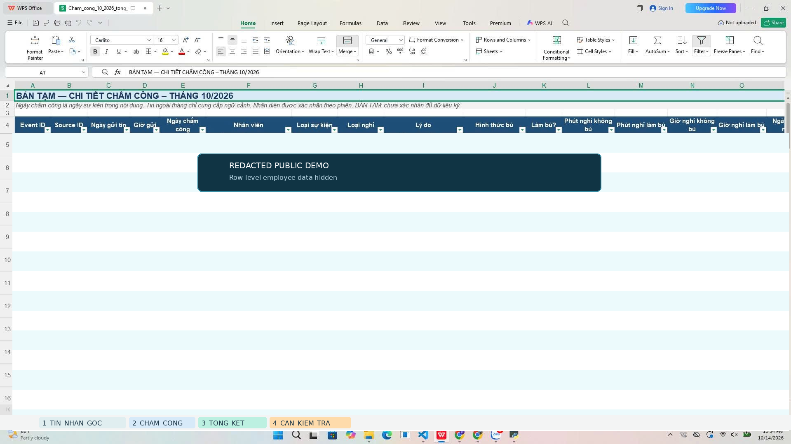
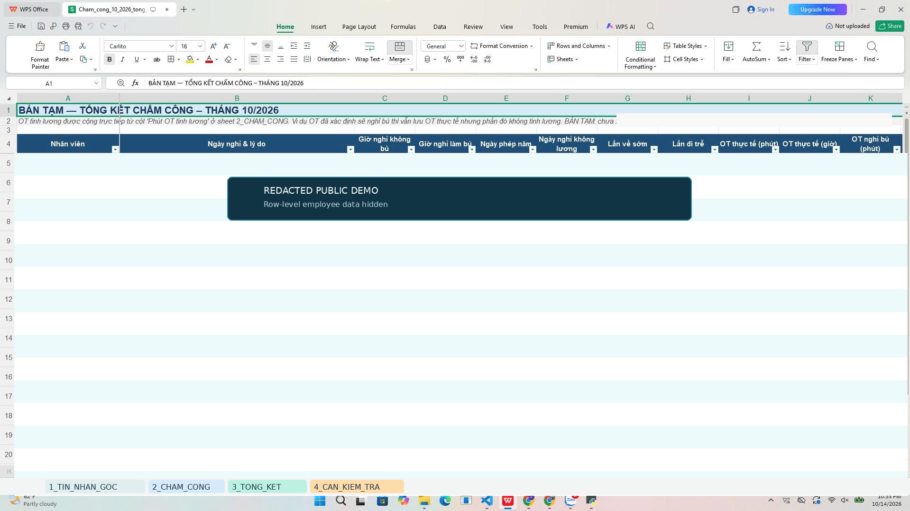

# AttendSift AI

**Chuyển báo cáo Chatwork thành bảng chấm công có thể kiểm tra và đối chiếu.**

Bộ phận AI · Đặng Gia Khánh · Phiên bản 1.0.2

[Hướng dẫn Windows](docs/INSTALL_WINDOWS.md) · [Vận hành website](docs/CLOUD_OPERATIONS.md) · [Bàn giao máy mới](docs/CHUYEN_MAY_WINDOWS.md) · [Kiểm chứng](docs/VERIFICATION_1.0.2.md) · [English](README_EN.md)

AttendSift AI hỗ trợ người phụ trách tổng hợp tin báo tăng ca, nghỉ, đi muộn và nghỉ bù trong Chatwork. Ứng dụng lưu tin nguồn, dùng AI hỗ trợ phân tích, áp dụng quy tắc nghiệp vụ và cho phép kiểm tra, chỉnh sửa trước khi xuất Excel. Mỗi kết quả có tham chiếu về tin gốc để đối chiếu.

**Trạng thái:** bản ứng viên phát hành để nghiệm thu nội bộ. Có kiểm thử tự động và quy trình đóng gói Windows; xem [bằng chứng kiểm chứng](docs/VERIFICATION_1.0.2.md). Việc chạy được trên máy build chưa thay thế nghiệm thu trên máy người nhận hoặc xác nhận độ chính xác với toàn bộ dữ liệu thực tế.

## Chọn cách sử dụng

| Nội dung | Windows Local | Website Cloud |
|---|---|---|
| Mở ứng dụng | EXE portable hoặc chạy từ mã nguồn | Trình duyệt, đăng nhập website |
| Lưu dữ liệu | SQLite trong thư mục ứng dụng | PostgreSQL trên Neon |
| Lịch đồng bộ | Windows Task Scheduler; máy cần bật, tài khoản đã đăng nhập | Vercel Cron, không cần máy cá nhân bật |
| Kết nối AI/Chatwork | Thiết lập riêng trên máy | Thiết lập riêng trên website |
| Tự xóa sau 3 tháng | Chưa áp dụng chính sách cloud | Có, khi cron hợp lệ chạy |
| Python trên máy người dùng | Không cần với gói EXE; cần nếu chạy mã nguồn | Không cần |

**Local và cloud không tự đồng bộ database hoặc khóa API với nhau.** Local lưu dữ liệu tại máy nhưng vẫn gửi nội dung cần phân tích tới nhà cung cấp AI được cấu hình. Internet và hạn mức API cần cho thao tác kết nối; gói phần mềm không bao gồm chi phí API.

## Quy trình làm việc

1. **Kết nối:** nhập token Chatwork, kiểm tra quyền và chọn phòng; cấu hình Gemini, OpenAI hoặc Claude với model được tài khoản hỗ trợ.
2. **Đồng bộ:** nhận tin gần nhất, lưu tin nguồn và kiểm tra phạm vi dữ liệu.
3. **Phân tích:** tách sự kiện theo nhân viên × ngày × loại; đối chiếu nguồn và quy tắc áp dụng.
4. **Rà soát:** kiểm tra trường hợp thiếu thông tin hoặc chưa chắc chắn; xác nhận, chỉnh sửa trước khi xuất.
5. **Xuất Excel:** lưu báo cáo 4 sheet và đối chiếu trước khi dùng chính thức.

| Sheet | Nội dung |
|---|---|
| `1_TIN_NHAN_GOC` | Nguồn tin dùng để đối chiếu |
| `2_CHAM_CONG` | Sự kiện chấm công chi tiết |
| `3_TONG_KET` | Tổng hợp theo nhân viên |
| `4_CAN_KIEM_TRA` | Những trường hợp cần rà soát |

## Quy tắc nghiệp vụ

- Một tin có thể tạo nhiều dòng cho nhiều người và nhiều ngày. OT của mỗi người được ghi riêng, không chia tổng phút cho số người.
- Ngày sự kiện được lấy từ nội dung có bằng chứng, có thể khác ngày gửi tin.
- Không tự suy đoán họ tên đầy đủ từ tên ngắn. Người được gắn rõ `(CTV)` và tin phép năm chỉ giữ nguồn theo chính sách hiện tại; tên ngắn không mặc nhiên bị coi là CTV.
- Đây là chính sách của phiên bản hiện tại, cần được đơn vị sử dụng xác nhận; không thay thế quy chế nhân sự của đơn vị.

Ví dụ **giả lập**: “Ngày 5/10: Lan OT 1h; Minh + Bình OT 2h” tạo ba dòng: Lan 60 phút, Minh 120 phút, Bình 120 phút. Xem [quy tắc nghiệp vụ](docs/BUSINESS_RULES.md).

## Cập nhật trong bản 1.0.2

- Danh sách cloud tự làm mới sau đồng bộ, hiển thị tổng số tin và phản hồi khi bộ lọc không hợp lệ.
- Thời gian tin nhắn cloud hiển thị `dd/mm/yyyy HH:mm:ss`, múi giờ Việt Nam GMT+7, giữ chuỗi ngày giờ trên một dòng.
- Cron chấp nhận hostname deployment thay đổi khi đúng endpoint và Bearer secret hợp lệ; các yêu cầu khác vẫn kiểm tra host.
- Cron dọn dữ liệu cloud cũ hơn 3 tháng và ngăn nhập lại tin nhắn quá hạn.
- Gộp hướng dẫn cài đặt, chuyển máy, vận hành cloud và thông tin kiểm chứng cho cùng một phiên bản.

## Bắt đầu trên Windows

### Người nhận gói EXE

1. Nhận `AttendSift-AI_Windows_1.0.2.zip` và checksum từ người bàn giao hoặc mục Releases khi đã được xuất bản.
2. Giải nén toàn bộ vào thư mục có quyền ghi, ví dụ `D:\AttendSift-AI`; không chạy bên trong ZIP.
3. Đọc `DOC_TRUOC_KHI_CHAY.html`, chạy `KIEM_TRA.bat`, rồi `BAT_DAU.bat`.
4. Nhập khóa của người sử dụng, thử dữ liệu giả và đối chiếu một file Excel trước khi nghiệm thu.

EXE portable dành cho Windows 10/11 x64, chưa ký số. Nếu bị chính sách máy chặn, gửi checksum cho IT kiểm tra. Xem [hướng dẫn bàn giao](docs/CHUYEN_MAY_WINDOWS.md).

### Người chạy mã nguồn

Cài Python 3.11 x64, giải nén mã nguồn rồi lần lượt chạy:

```text
CAI_DAT_WINDOWS.bat
KIEM_TRA_LOCAL_WINDOWS.bat
CHAY_LOCAL_WINDOWS.bat
```

Địa chỉ mặc định: `http://127.0.0.1:8766`. ZIP mã nguồn không chứa sẵn EXE. Xem [hướng dẫn cài đặt](docs/INSTALL_WINDOWS.md).

## Dữ liệu cloud và thời hạn lưu

Cron được cấu hình mỗi ngày lúc **13:00 giờ Việt Nam** (`0 6 * * *` UTC); thời điểm thực thi thực tế phụ thuộc dịch vụ hosting. Chỉ yêu cầu có `CRON_SECRET` hợp lệ được thực hiện tác vụ dọn.

- Tin nhắn: quá 3 tháng tính từ thời điểm gửi.
- Phiên phân tích, kết quả và Excel liên quan: quá 3 tháng tính từ thời điểm tạo phiên. Bản chụp nguồn trong phiên đi theo thời hạn của phiên.
- Lịch sử thao tác và bản sửa tin nhắn được dọn theo [chính sách chi tiết](docs/RETENTION_3_MONTHS.md).
- Cấu hình và khóa kết nối được giữ lại. File đã tải về máy không bị tác động.

**Tải báo cáo cần lưu lâu dài trước hạn.** Dữ liệu quá hạn có thể bị xóa ngay ở lần cron hợp lệ đầu tiên sau triển khai. Thời hạn lưu giúp kiểm soát tích lũy, không bảo đảm dữ liệu 3 tháng luôn vừa hạn mức miễn phí. Xem [vận hành cloud](docs/CLOUD_OPERATIONS.md).

## Giới hạn cần biết

Chatwork có thể chỉ trả cửa sổ tối đa 100 tin gần nhất trong một lần lấy dữ liệu. Đồng bộ thành công không chứng minh đã có đầy đủ lịch sử tháng; cần đối chiếu nguồn trước khi xuất. Local hỗ trợ nhập lịch sử được lưu hợp lệ.

AI có thể nhầm người, ngày hoặc thời lượng. Người phụ trách cần kiểm tra trước khi dùng chính thức. Kiểm thử tự động không thay thế nghiệm thu trên máy người nhận, kiểm tra Microsoft Excel, API thật hoặc PostgreSQL staging.

## Giao diện



| Nguồn tin | Chi tiết chấm công | Tổng kết |
|---|---|---|
|  |  |  |

Ảnh minh họa Local đã che thông tin cá nhân; không xác nhận bố cục cloud mới nhất hoặc độ chính xác trên toàn bộ dữ liệu thực tế.

## Dành cho người bảo trì

```text
src/                  Local: SQLite, đồng bộ, phân tích, xuất Excel
cloud/                Cloud: Flask, PostgreSQL, xác thực, cron, retention
static/, templates/   Giao diện và mẫu workbook Local
public/static/        Tài nguyên cloud phục vụ qua hosting
tests/                Kiểm thử bằng dữ liệu giả lập
tools/                Chẩn đoán, kiểm tra và đóng gói
docs/                 Sử dụng, vận hành, kiểm chứng và bàn giao
```

Xem [kiểm thử](docs/TESTING.md), [checklist phát hành](docs/RELEASE_CHECKLIST.md), [đăng GitHub](docs/PUBLISH_1.0.2.md), [changelog](CHANGELOG.md), [kiến trúc](docs/ARCHITECTURE.md).

## Hỗ trợ và quyền sử dụng

Bảo trì: **Bộ phận AI · Đặng Gia Khánh**. Khi báo lỗi, gửi phiên bản, bước tái hiện và thông báo đã che dữ liệu; không gửi API key, database, tin nhân viên hoặc Excel thật lên GitHub. Xem [CONTRIBUTING](CONTRIBUTING.md) và [SECURITY](SECURITY.md).

Dự án chưa cấp giấy phép mã nguồn mở; xem [LICENSE_DECISION](LICENSE_DECISION.md). Quyền sử dụng và phân phối cần được chủ sở hữu xác nhận. Giấy phép thư viện bên thứ ba vẫn áp dụng. Ứng dụng không liên kết chính thức với Chatwork hay nhà cung cấp AI.
