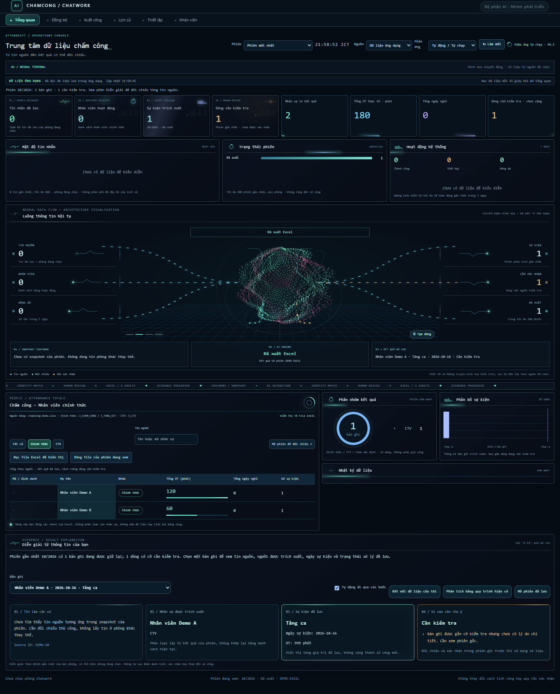
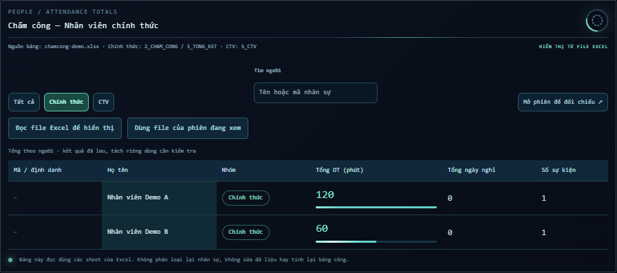
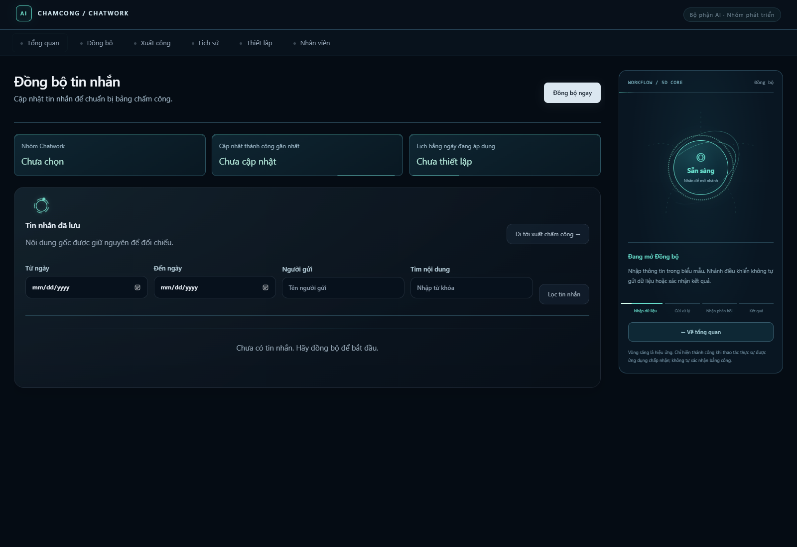
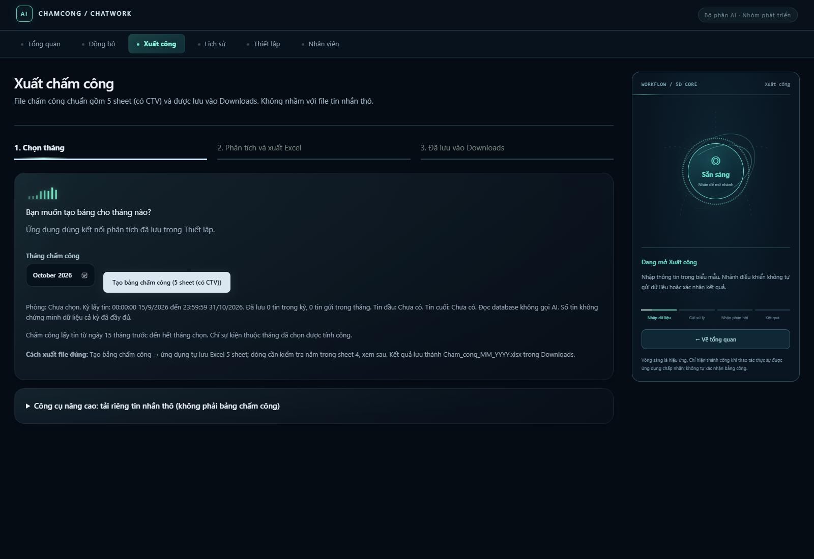
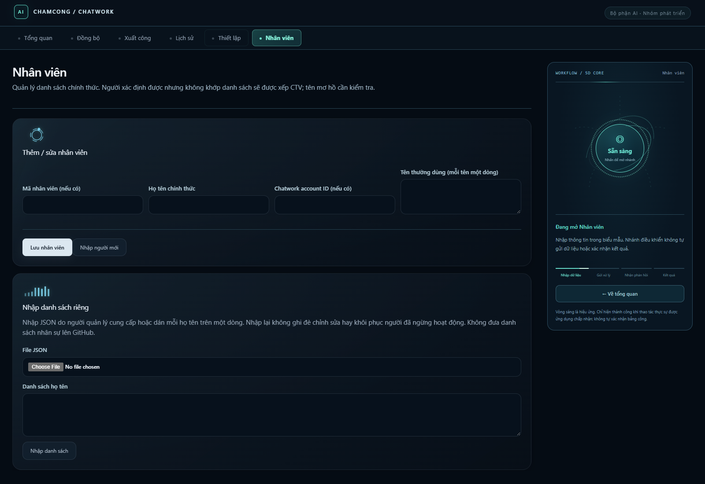
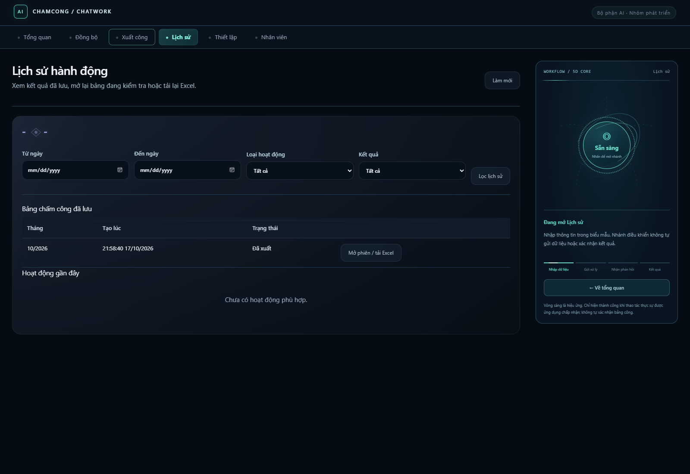
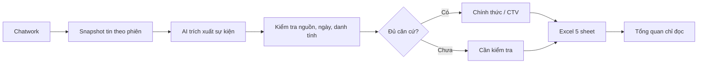

<div align="center">

# AttendSift AI

### Từ tin nhắn Chatwork đến bảng chấm công có thể đối chiếu.

**Trích xuất bằng AI · Kiểm tra theo quy tắc · Xác nhận bởi con người · Xuất Excel 5 sheet**

[**Bắt đầu trên Windows**](docs/INSTALL_WINDOWS.md) · [**Xem cách xử lý**](docs/BUSINESS_RULES.md) · [**Kiến trúc**](docs/ARCHITECTURE.md) · [**English**](README_EN.md)



<sub>Giao diện Neural Terminal V6.2 của bản Windows Local. Hình minh họa dùng dữ liệu giả lập; không phải kết quả chạy trên dữ liệu doanh nghiệp thật.</sub>

</div>

## Vì sao cần AttendSift AI?

Báo công trong Chatwork không phải lúc nào cũng là một dòng dữ liệu chuẩn: **một người báo hộ cả nhóm, ngày nhắn khác ngày làm, tên thường gọi trùng nhau hoặc số phút tăng ca chưa rõ**. Nếu đưa thẳng kết quả AI vào bảng công, những trường hợp này rất dễ bị tính nhầm.

AttendSift AI giúp người phụ trách **thu thập tin nguồn → trích xuất sự kiện → kiểm tra danh tính và quy tắc → rà soát các dòng chưa rõ → xuất Excel**. Mỗi kết quả cần có căn cứ; **AI hỗ trợ đọc tin, không tự thay thế quyết định chấm công**.

| Tình huống thực tế | Cách hệ thống xử lý |
| --- | --- |
| Một tin báo tăng ca cho nhiều người | Tách sự kiện theo người/ngày/thời lượng; không chia đều số phút chung |
| Tin nhắn gửi hôm sau | Dùng ngày làm việc được nêu khi có đủ căn cứ |
| Tên thường gọi khớp nhiều người | Chuyển sang **Cần kiểm tra**; không tự chọn nhân viên để cộng công |
| Nhân viên chính thức và cộng tác viên (CTV) | Đối chiếu và xuất số liệu riêng theo trạng thái đã lưu của phiên |
| Cần giải thích một dòng tổng kết | Tìm ngược về **Source ID** và tin trong snapshot của phiên |

## Xem sản phẩm

**Neural Terminal** là bảng điều khiển của bản **Windows Local V6.2**: hiển thị trạng thái đồng bộ, phiên phân tích, kết quả đối chiếu và các biểu đồ chuyển động. Hiệu ứng chỉ phục vụ quan sát, **không thay đổi số liệu, không tự xác nhận sự kiện và không gọi thêm AI**. Chế độ giao diện thứ hai (Operations Room) đã được bỏ.

<div align="center">
  
  <br>
  <sub>Bảng tổng theo người: phân tách nhân viên chính thức và CTV, đọc từ workbook đã chọn.</sub>
</div>

**Năm khu vực nghiệp vụ:** Đồng bộ · Xuất công · Lịch sử · Thiết lập · Nhân viên.

<details>
<summary><strong>Xem thêm ảnh giao diện từng bước</strong></summary>

| Đồng bộ tin nguồn | Xuất báo cáo |
| :---: | :---: |
|  |  |

| Quản lý nhân viên | Lịch sử phiên |
| :---: | :---: |
|  |  |

[Ảnh động Neural Terminal](docs/images/neural-motion.gif) · [Màn hình Thiết lập](docs/images/ui-settings.png)

</details>

## Excel 5 sheet: kiểm tra được đến tin nguồn

| Sheet | Bạn nhận được gì? |
| --- | --- |
| `1_TIN_NHAN_GOC` | Tin nguồn, thời gian gửi, Source ID và liên kết sự kiện |
| `2_CHAM_CONG` | Chi tiết chấm công của nhân viên chính thức |
| `3_TONG_KET` | Tổng hợp nhân viên chính thức |
| `4_CAN_KIEM_TRA` | Sự kiện thiếu căn cứ / chưa xác nhận, **chưa đưa vào tổng công** |
| `5_CTV` | Chi tiết và tổng kết riêng cho CTV |

Bảng tổng quan **đọc dữ liệu đã có trong Excel**: chính thức từ `2_CHAM_CONG` và `3_TONG_KET`, CTV từ `5_CTV`. Có thể chọn workbook khác để xem rồi quay lại workbook của phiên. Thao tác đọc không sửa file, không phân loại lại nhân sự và không tính lại công thức Excel. Ô công thức chưa có kết quả lưu sẽ hiển thị là chưa có giá trị, **không tự đổi thành 0**.

[Xem quy tắc nghiệp vụ](docs/BUSINESS_RULES.md) · [Mẫu báo công](docs/MAU_BAO_CAO_CHAM_CONG.md) · [Chính sách nghỉ 30 phút có lương](docs/CHINH_SACH_NGHI_30_PHUT_CO_LUONG.md)

## Bắt đầu sử dụng

### Cách 1 — Windows: dùng bản EXE bàn giao

1. Nhận **bộ chạy sạch** từ người phát hành và giải nén toàn bộ trên Windows 10/11 x64.
2. Mở `1_CHAY_UNG_DUNG/ChamCong.exe` (không cần cài Python; cần môi trường Windows/WebView2 phù hợp).
3. Ở **Nhân viên**, nhập danh sách nhân viên của đơn vị. Ở **Thiết lập**, cấu hình phòng Chatwork và nhà cung cấp AI.
4. **Đồng bộ → Xuất công → kiểm tra dòng cần rà soát → xuất Excel**.

> **Lưu ý:** Repository GitHub này chỉ chứa mã nguồn và hình minh họa, **không phát hành EXE cùng database, token, log hay dữ liệu nhân viên**. Khi cập nhật máy đang dùng, hãy sao lưu dữ liệu và giữ thư mục dữ liệu hiện có; không thay toàn bộ thư mục chạy bằng một bộ chứa dữ liệu khác.

[Hướng dẫn Windows đầy đủ](docs/INSTALL_WINDOWS.md)

### Cách 2 — Chạy mã nguồn trên Windows (Python 3.11)

```powershell
git clone https://github.com/danggiakhanhgl2022-hash/AttendSift-AI.git
cd AttendSift-AI
py -3.11 -m venv .venv
.venv\Scripts\python.exe -m pip install -r requirements-local.txt
.venv\Scripts\python.exe tools/run_local.py
```

Ứng dụng Local mở tại **http://127.0.0.1:8766** và sử dụng SQLite trên máy; cần Internet khi gọi Chatwork hoặc dịch vụ AI đã cấu hình. Có thể dùng `CAI_DAT_WINDOWS.bat` / `CHAY_LOCAL_WINDOWS.bat` hoặc build EXE với `build.bat` trên Windows.

### Cách 3 — Cloud (triển khai riêng)

Cloud dùng Flask và PostgreSQL, cấu hình hosting và secrets riêng. **Local và Cloud không tự đồng bộ** database, danh sách nhân viên hoặc khóa. Giao diện Neural Terminal V6.2 mô tả ở trang này thuộc **Windows Local**, không phải lời cam kết rằng Cloud có cùng giao diện.

[Hướng dẫn triển khai Cloud](docs/CLOUD_OPERATIONS.md) · [Mẫu biến môi trường](.env.example)

## Cách hoạt động



| Thành phần | Công nghệ / vai trò |
| --- | --- |
| Windows Local | Python, Flask, SQLite, giao diện loopback/WebView2 |
| Trích xuất AI | Dịch vụ AI do đơn vị cấu hình; đầu ra qua lớp kiểm tra nghiệp vụ |
| Báo cáo | `openpyxl`, workbook có nguồn và các nhóm kết quả riêng |
| Cloud | Flask, PostgreSQL, cấu hình hosting và cron riêng |
| Kiểm thử | `pytest`, bộ kiểm tra tài liệu/bảo mật, kiểm thử giao diện dùng dữ liệu giả lập |

Mã nguồn nằm ở `src/` (nghiệp vụ Local), `cloud/` (Cloud), `static/` và `templates/` (giao diện), `tests/` (kiểm thử), `tools/` (công cụ), `docs/` (hướng dẫn). Một số tài nguyên có mặt ở nhiều thư mục vì đường phục vụ tài nguyên của Local và Cloud khác nhau; **không xóa file chỉ vì nội dung trùng**.

[Đọc kiến trúc chi tiết](docs/ARCHITECTURE.md)

## Kiểm chứng và giới hạn

Tài liệu bàn giao ngày **17/10/2026** ghi nhận **405 bài kiểm thử Python đạt** trên môi trường Local của tác giả. Đây là kết quả kiểm thử được báo cáo, **không phải tỷ lệ chính xác AI, SLA hay chứng nhận hoạt động trên dữ liệu thực tế**. Để tự kiểm tra trên máy đã cài dependencies:

```powershell
.venv\Scripts\python.exe -m pytest -q -p no:cacheprovider tests
.venv\Scripts\python.exe tools/check_documentation.py
.venv\Scripts\python.exe tools/privacy_audit.py .
```

Phạm vi chưa được các kiểm thử giả lập chứng minh: độ đầy đủ lịch sử Chatwork, kết quả từ tài khoản/API thật, WebView trên mọi máy Windows, và tính chính xác của từng quyết định nghiệp vụ. Người phụ trách phải rà soát các dòng chưa xác minh trước khi sử dụng để tính công/lương.

[Phạm vi kiểm thử](docs/TESTING.md) · [Bản ghi kiểm thử giao diện](docs/verification/workbook-overview.json) · [Lịch sử thay đổi](CHANGELOG.md)

## Quyền riêng tư, giấy phép và hỗ trợ

- **Không commit:** `.env`, API key/token, `*.db`, `*.credentials`, log, backup, workbook chấm công thật, tên hoặc tin nhắn nhân viên thật. Dữ liệu phân tích có thể được gửi tới dịch vụ AI mà người vận hành cấu hình.
- **Khi báo lỗi:** mở [GitHub Issues](https://github.com/danggiakhanhgl2022-hash/AttendSift-AI/issues) và cung cấp phiên bản, bước tái hiện, log **đã che sạch dữ liệu nhạy cảm**.
- **Giấy phép:** repository hiện **chưa công bố giấy phép mã nguồn mở**. Quyền xem mã nguồn công khai không tự động cấp quyền sao chép hoặc phân phối; xem [License decision](LICENSE_DECISION.md).
- **Đóng góp:** dùng dữ liệu giả lập, đọc [CONTRIBUTING.md](CONTRIBUTING.md) và [SECURITY.md](SECURITY.md) trước khi gửi PR.

<div align="center">

**AttendSift AI · Đặng Gia Khánh · Bộ phận AI**

[Hướng dẫn sử dụng](docs/README.md) · [Bảo mật và quyền riêng tư](docs/PRIVACY_AND_SECURITY.md) · [Xem thay đổi](CHANGELOG.md)

<sub>Dự án độc lập; không được Chatwork hoặc nhà cung cấp AI chứng nhận.</sub>

</div>
