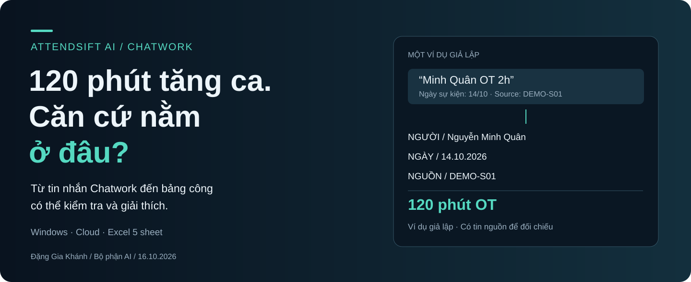
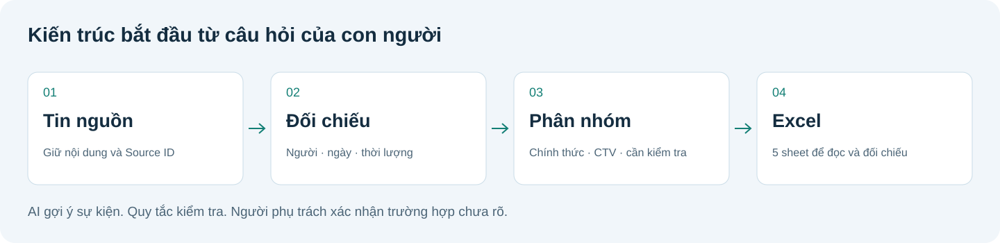
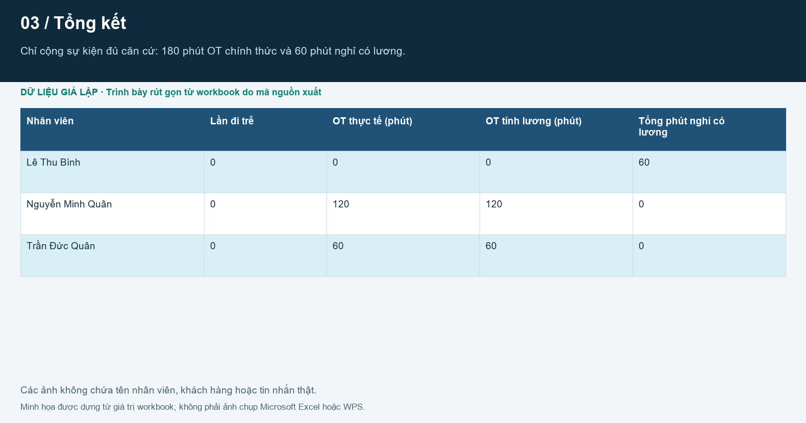
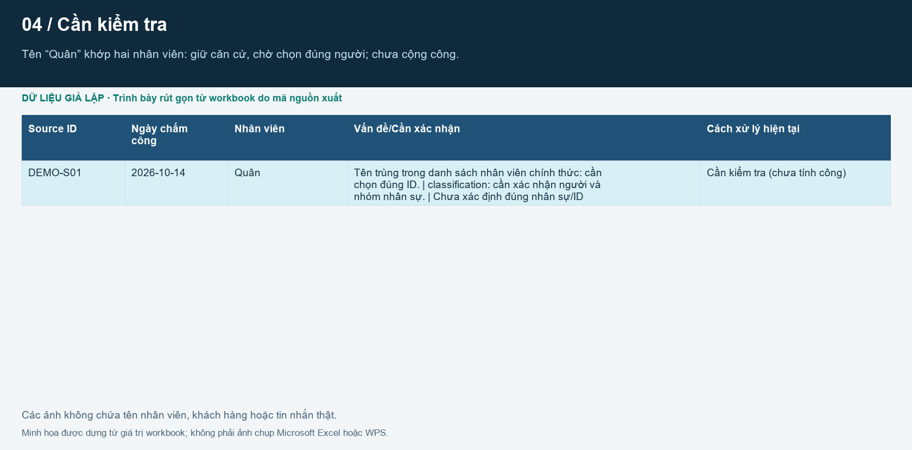
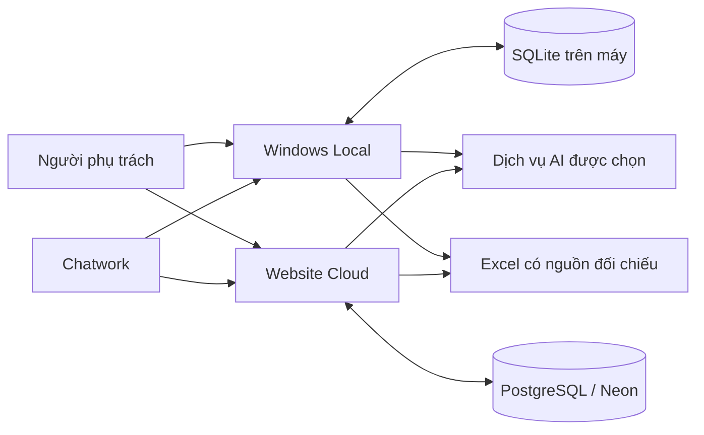

<p align="center"></p>

# AttendSift AI

**Từ báo cáo Chatwork đến bảng chấm công có thể giải thích, đối chiếu và kiểm tra lại.**

Bộ phận AI · **Đặng Gia Khánh** · Phiên bản nền **1.1.0** · Cập nhật **16/10/2026** · Bản ứng viên phát hành

[Bắt đầu trên Windows](docs/INSTALL_WINDOWS.md) · [Vận hành Cloud](docs/CLOUD_OPERATIONS.md) · [Bộ ảnh sản phẩm](docs/PRODUCT_TOUR.md) · [Kiến trúc](docs/ARCHITECTURE.md) · [English](README_EN.md)

AttendSift AI giúp người phụ trách tổng hợp tăng ca, đi trễ, về sớm và các sự kiện chấm công từ tin nhắn tự do. Ứng dụng giữ tin nguồn, dùng AI hỗ trợ đọc nội dung, đối chiếu danh sách nhân viên và xuất **một workbook Excel gồm 5 sheet**. Mỗi dòng chưa rõ được giữ riêng để kiểm tra, chưa cộng vào tổng công.

**Có cả Windows Local và Website Cloud trong cùng repository.** Ảnh giao diện dưới đây được chụp từ bản Local với dữ liệu giả lập; đây là giao diện web chạy trong EXE Windows. Bản Cloud dùng trình duyệt và đăng nhập quản trị, có lưu trữ và lịch chạy riêng.

## Đọc theo điều bạn cần

| Bạn đang muốn… | Bắt đầu ở đây |
|---|---|
| Hiểu sản phẩm và xem đầu ra | [Giao diện](#một-quy-trình-năm-tab) · [Excel](#đầu-ra-một-workbook-năm-sheet) |
| Chạy thử hoặc bàn giao | [Windows](docs/INSTALL_WINDOWS.md) · [Cloud](docs/CLOUD_OPERATIONS.md) · [Mẫu báo công](docs/MAU_BAO_CAO_CHAM_CONG.md) |
| Đánh giá cách thiết kế | [Kiến trúc](docs/ARCHITECTURE.md) · [Lựa chọn và đánh đổi](docs/articles/05-LUA_CHON_VA_DANH_DOI.md) |
| Xem bằng chứng và giới hạn | [Kiểm chứng hiện tại](docs/UPDATE_2026-10-16.md) · [Phạm vi kiểm thử](docs/articles/06-KIEM_CHUNG_VA_GIOI_HAN.md) |
| Đọc câu chuyện phát triển | [Loạt bài](docs/articles/README.md) · [Portfolio](docs/PORTFOLIO_STORY.md) |

## Bắt đầu từ công việc của con người

Một tin nhắn có thể báo hộ nhiều người, nhắc ngày hôm trước và dùng tên thường gọi. Người tổng hợp cần biết **ai làm, ngày nào, bao nhiêu phút và tin nào là căn cứ**. Một con số tổng hợp chưa đủ nếu không giải thích được vì sao nó xuất hiện.

AttendSift AI tổ chức công việc theo ba điểm:

| Điểm nhấn | Giá trị khi sử dụng | Điều kiện cần giữ |
|---|---|---|
| **Truy được nguồn** | Từ một dòng Excel quay lại Source ID và nội dung tin | Tin nguồn phải được thu thập đủ; không lấy khoảng trống làm bằng chứng vắng mặt |
| **Phân loại có căn cứ** | Tách chính thức/CTV, tên trùng và phút nghỉ có lương | Danh sách nhân viên và tên thường dùng cần được cập nhật đúng |
| **Kiểm tra được sau khi xuất** | Có file để đọc ngay; dòng chưa xác minh nằm riêng | Người phụ trách phải xử lý dòng chưa rõ trước khi dùng số liệu chính thức |



AI hỗ trợ trích xuất. Bộ quy tắc kiểm tra tính hợp lệ. Người phụ trách giữ quyền sửa và xác nhận. Giá trị của thiết kế nằm ở việc nối ba vai trò này thành một quy trình có thể xem lại.

## Một quy trình, năm tab


*Ảnh giao diện thật được dựng trong môi trường demo độc lập. Tên phòng, người và tin nhắn đều giả lập; không dùng database của người sử dụng.*

| Tab | Công việc | Kết quả cần kiểm tra |
|---|---|---|
| **Đồng bộ** | Lấy và lọc tin Chatwork theo kỳ, người gửi, nội dung | Phòng đúng, khoảng thời gian đúng, mức đầy đủ của lịch sử |
| **Xuất công** | Chọn tháng, phân tích và lưu workbook | Dòng có căn cứ được tính; dòng chưa rõ được giữ ở sheet 4 |
| **Lịch sử** | Mở phiên, xem hoạt động, tải lại báo cáo | Phiên nào đã tạo số liệu, lúc nào đã sửa hoặc xác nhận |
| **Thiết lập** | Chọn Chatwork, dịch vụ AI, nhóm và lịch đồng bộ | Khóa được nhập riêng; giới hạn API được người vận hành chuẩn bị |
| **Nhân viên** | Thêm, sửa, ngừng hoạt động và nhập danh sách | Tên chính thức, tên thường dùng, mã hoặc Chatwork ID đủ căn cứ |

<table>
<tr><td width="50%"><br><strong>Xuất công</strong> — theo kỳ và theo phiên</td><td width="50%"><br><strong>Nhân viên</strong> — nguồn đối chiếu nhân sự</td></tr>
</table>

Xem đủ 5 tab và chú thích từng màn hình tại [Bộ ảnh sản phẩm](docs/PRODUCT_TOUR.md). Cảnh xe 3D là phần trình bày giao diện hiện có; nó không tham gia quyết định chấm công.

## Thử hiểu bằng một ví dụ

Danh sách chính thức có **Nguyễn Minh Quân**, **Trần Đức Quân**, **Lê Thu Bình**. Một báo cáo giả lập ghi:

```text
Team Demo: ngày 14/10
Minh Quân OT 2h
Đức Quân OT 1h
Quân OT 30p
Lan Demo (CTV) OT 45p
```

| Nội dung | Xử lý | Vào tổng nào? |
|---|---|---|
| Minh Quân OT 2h | Khớp duy nhất Nguyễn Minh Quân | 120 phút OT chính thức |
| Đức Quân OT 1h | Khớp duy nhất Trần Đức Quân | 60 phút OT chính thức |
| Quân OT 30p | Có hai người cùng tên Quân; chưa chọn được ID | Sheet kiểm tra, chưa tính công |
| Lan Demo (CTV) OT 45p | Danh tính ngoài danh sách chính thức | 45 phút OT CTV, giữ riêng |

Nếu Lê Thu Bình tự báo “Em xin phép về sớm 30 phút không làm bù” vào ngày 14 và 16/10, có đủ căn cứ ngày/người/nội dung thì ghi **60 phút nghỉ có lương**. Không tự tạo ngày 15/10; không biến 60 phút này thành thiếu giờ hoặc OT.

Đây là tình huống kiểm chứng giả lập, không phải dữ liệu nhân viên thật hoặc số liệu hiệu năng của sản phẩm.

## Đầu ra: một workbook, năm sheet



| Sheet | Bạn dùng để làm gì? |
|---|---|
| `1_TIN_NHAN_GOC` | Đọc nội dung nguồn, ngày gửi, ngày sự kiện liên quan và Source ID |
| `2_CHAM_CONG` | Xem chi tiết sự kiện đủ căn cứ của nhân viên chính thức |
| `3_TONG_KET` | Đọc tổng theo người, tách OT và phút nghỉ có lương |
| `4_CAN_KIEM_TRA` | Xử lý tên trùng, thiếu bằng chứng, lỗi kiểm tra và dấu vết xác nhận |
| `5_CTV` | Đối chiếu sự kiện và tổng riêng của CTV; không cộng vào chính thức |



*Hình Excel được dựng từ giá trị thực của workbook do mã xuất bằng fixture giả lập, chọn một số cột để dễ đọc. Đây không phải ảnh nghiệm thu Microsoft Excel hoặc WPS. [Xem toàn bộ 5 sheet](docs/PRODUCT_TOUR.md#excel-năm-góc-nhìn-của-cùng-một-báo-cáo).*

File `TinNhan_...xlsx` là bản tin thô để đối chiếu, không thay thế báo cáo chấm công `Cham_cong_MM_YYYY.xlsx`. Bản Local lưu báo cáo vào Downloads và có bản lưu theo phiên; Cloud lưu file theo phiên để tải qua trình duyệt.

## Cập nhật ngày 16/10/2026

- **Nghỉ 30 phút có lương:** nhận đúng tin tự báo có căn cứ; thêm cột AB ở chi tiết, O ở tổng kết và L ở CTV. Giữ vị trí các cột trước đó.
- **Đối chiếu danh sách:** dùng họ tên, tên đệm + tên hoặc tên thường dùng khớp duy nhất. Tài khoản người báo hộ không chứng minh danh tính cả nhóm.
- **Xuất trước, kiểm tra sau:** dòng chưa xác minh không được cộng công; mở lại phiên đã xuất để sửa và xuất bản cập nhật.
- **Sửa luồng xác nhận:** giữ phút nghỉ có lương và kiểm tra lại chính dữ liệu sẽ ghi Excel.

Tin chỉ xin nghỉ/phép năm được giữ ở nguồn theo quy tắc hiện tại, không tự cộng ngày nghỉ từ suy đoán AI. Đi trễ 30 phút hoặc về sớm 45 phút không tự được coi là nghỉ 30 phút có lương. Đây là quy tắc sản phẩm theo yêu cầu đơn vị, không phải mô tả quy định pháp luật.

[Chi tiết chính sách](docs/CHINH_SACH_NGHI_30_PHUT_CO_LUONG.md) · [Quy tắc nghiệp vụ](docs/BUSINESS_RULES.md) · [Changelog](CHANGELOG.md)

## Kiến trúc dễ đi theo, đủ rõ để bảo trì



Hai chế độ dùng chung các quy tắc nhân sự, đối chiếu nguồn và xuất workbook. Lớp điều phối, lưu trữ, xác thực và lịch chạy được tổ chức theo môi trường. Local và Cloud **không tự đồng bộ database, danh sách hoặc khóa**.

| Quyết định giữ lại | Lợi ích | Nhược điểm và cách giảm |
|---|---|---|
| Một ứng dụng chia mô-đun cho mỗi chế độ | Dễ đóng gói, ít thành phần cần vận hành | Ranh giới mô-đun cần kỷ luật; dùng kiểm thử trên cả hai luồng |
| Bản chụp nguồn và danh sách theo phiên | Giải thích kết quả cũ | Tăng dung lượng; quản lý retention và tải báo cáo cần giữ |
| AI kết hợp kiểm tra xác định | Đọc tin linh hoạt, có lớp đối chiếu | Còn trường hợp chưa hiểu; giữ nguồn và hàng kiểm tra |
| Excel 5 sheet | Phù hợp cách bàn giao, đọc được từng lớp dữ liệu | File rộng; chia vai trò từng sheet và hướng dẫn người đọc |

[Kiến trúc từ con người đến mô-đun](docs/ARCHITECTURE.md) · [Phân tích lựa chọn](docs/articles/05-LUA_CHON_VA_DANH_DOI.md)

## Chọn nơi sử dụng

| | Windows Local | Website Cloud |
|---|---|---|
| Mở | `ChamCong.exe` hoặc mã Python; WebView2/trình duyệt loopback | Trình duyệt có đăng nhập quản trị |
| Dữ liệu | SQLite tại máy | PostgreSQL trên Neon |
| Lịch | Task Scheduler; máy bật và đúng tài khoản | Vercel Cron và cấu hình hosting |
| Danh sách | Nhập riêng tại tab Nhân viên | Người quản trị nhập riêng tại tab Nhân viên |
| Lưu trữ dài hạn | Người vận hành quản lý và sao lưu | Dữ liệu nghiệp vụ theo chính sách 3 tháng; giữ danh sách nhân viên |
| Cần chuẩn bị | Windows, quyền ghi, kết nối API khi dùng | Hosting, database, secrets và giới hạn dịch vụ |

Chế độ Local vẫn gửi nội dung cần phân tích tới dịch vụ AI được chọn. Hạn mức dịch vụ, Internet và chính sách dữ liệu cần được đơn vị chuẩn bị. [So sánh và cách chọn](docs/articles/04-WINDOWS_VA_CLOUD.md).

## Bắt đầu và bàn giao

**Dùng EXE:** nhận bản build được xác nhận, đặt trong thư mục có quyền ghi và mở `ChamCong.exe`. Nhập khóa của chính nơi sử dụng tại Thiết lập, thêm danh sách nhân viên, thử bằng dữ liệu giả lập rồi nghiệm thu Excel. EXE bàn giao riêng, không có trong gói mã nguồn GitHub. File khởi tạo nhân sự nội bộ nếu có phải được chuyển riêng.

**Chạy từ mã nguồn:** Python 3.11 x64 → `CAI_DAT_WINDOWS.bat` → `KIEM_TRA_LOCAL_WINDOWS.bat` → `CHAY_LOCAL_WINDOWS.bat`. Địa chỉ Local mặc định `http://127.0.0.1:8766`. Dùng `TAO_EXE_WINDOWS.bat` khi cần đóng gói lại.

**Vận hành Cloud:** xem [hướng dẫn Cloud](docs/CLOUD_OPERATIONS.md), [thiết lập](docs/SETUP.md) và [lưu trữ 3 tháng](docs/RETENTION_3_MONTHS.md). Các biến bí mật được đặt trong môi trường hosting, không đưa vào Git.

EXE chưa ký số; máy người nhận cần được nghiệm thu WebView2, quyền ghi, Downloads và lịch chạy. Cập nhật mã trên GitHub không tự cập nhật EXE đã cài trên máy khác.

## Loạt bài: từ công việc đến lựa chọn thiết kế

| Bài | Câu hỏi trung tâm |
|---|---|
| [01. Thiết kế theo người dùng](docs/articles/01-TU_CONG_VIEC_DEN_THIET_KE.md) | Người phụ trách cần thấy điều gì trước? |
| [02. AI và bằng chứng](docs/articles/02-AI_VA_BANG_CHUNG.md) | Làm sao dùng AI mà vẫn kiểm tra được kết quả? |
| [03. Excel như một giao diện bàn giao](docs/articles/03-EXCEL_LA_GIAO_DIEN_BAN_GIAO.md) | Vì sao cần đủ 5 sheet và cách đọc từng sheet? |
| [04. Windows và Cloud](docs/articles/04-WINDOWS_VA_CLOUD.md) | Tính năng chung, trách nhiệm vận hành khác nhau ở đâu? |
| [05. Lựa chọn và đánh đổi](docs/articles/05-LUA_CHON_VA_DANH_DOI.md) | Giữ điều gì, giảm nhược điểm thế nào và khi nào đổi? |
| [06. Kiểm chứng và giới hạn](docs/articles/06-KIEM_CHUNG_VA_GIOI_HAN.md) | Điều gì đã được thử và điều gì còn cần nghiệm thu? |

Cách trình bày được đối chiếu với bài có tác giả trên **InfoQ**, **Stack Overflow Blog** và hướng dẫn **C4**, **Diátaxis**, **GitHub Docs**. Đây là nguồn tham khảo cho quyết định biên tập và kiến trúc; không phải chứng nhận sản phẩm hay bảng xếp hạng diễn đàn. [Nguồn, ngày đọc và cách chọn ý tưởng](docs/ARCHITECTURE_REVIEW_1.1.0.md).

## Bằng chứng và giới hạn

**395 kiểm thử Python đạt** trong lần kiểm tra Windows/Python 3.11.9 ngày 16/10/2026. Có kiểm tra thư viện/mẫu workbook của EXE và kiểm tra gói nguồn, UTF-8. Các tình huống nghiệp vụ dùng dữ liệu giả lập, không gọi Chatwork hoặc AI thật.

Số kiểm thử không phải tỷ lệ chính xác, thời gian tiết kiệm hoặc khả năng chịu tải. Chatwork có thể chỉ trả cửa sổ tin gần nhất; đồng bộ thành công không chứng minh đủ cả tháng. Cloud có giới hạn thời gian request, kích thước file và thời hạn lưu. Cần nghiệm thu riêng API thật, PostgreSQL staging, Microsoft Excel/WPS và máy Windows độc lập.

[Kết quả hiện tại](docs/UPDATE_2026-10-16.md) · [Phương pháp kiểm thử](docs/TESTING.md) · [Biên bản bàn giao](docs/HANDOVER_ACCEPTANCE.md)

## Quyền riêng tư, quyền sử dụng và hỗ trợ

Ảnh mới và ví dụ trong README dùng dữ liệu giả lập. Token Chatwork, khóa AI, database, danh sách nhân sự và Excel thật không thuộc mã nguồn công khai. Không tải cả thư mục chạy ứng dụng lên GitHub; dùng gói nguồn đã kiểm tra.

Khi báo lỗi, gửi phiên bản, bước tái hiện và thông báo đã che dữ liệu. Dự án chưa cấp giấy phép mã nguồn mở và không liên kết chính thức với Chatwork hoặc nhà cung cấp AI.

[Bảo mật](SECURITY.md) · [Đóng góp](CONTRIBUTING.md) · [Quyền sử dụng](LICENSE_DECISION.md) · [Mục lục tài liệu](docs/README.md)
