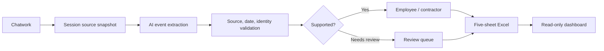

<div align="center">

# AttendSift AI

### From Chatwork messages to auditable attendance reports.

**AI-assisted extraction · Rule-based validation · Human review · Five-sheet Excel exports**

[**Windows setup**](docs/INSTALL_WINDOWS.md) · [**Business rules**](docs/BUSINESS_RULES.md) · [**Architecture**](docs/ARCHITECTURE.md) · [**Tiếng Việt**](README.md)


<sub>Neural Terminal V6.2 for Windows Local. Screenshots use synthetic demonstration data, not real employee records.</sub>

</div>

## The problem

Chatwork attendance messages are not structured timesheets. A single message can report overtime for several employees; the event date may differ from the message date; names may be ambiguous. Automatically including uncertain AI extractions in payroll can lead to mistakes.

**AttendSift AI** collects and preserves source messages, extracts candidate events with AI, validates identity/date/duration against business rules, keeps ambiguous rows for human review, and exports an **auditable Excel workbook**. AI assists the operator; it does **not** make final attendance decisions on its own.

| Situation | How AttendSift AI responds |
| --- | --- |
| One person reports overtime for a team | Extracts individual events; does not split a shared duration equally |
| Message date differs from work date | Uses the documented event date when supported by the source |
| Multiple employees match a nickname | Sends the row for review, rather than arbitrarily assigning an employee |
| Employees and contractors | Keeps official employee and contractor (CTV) results separate |
| An overtime total needs explanation | Links the event back to its Source ID and session snapshot |

## Product preview

The **Windows Local V6.2 Neural Terminal** displays synchronization, analysis sessions, review status, and read-only attendance totals, with motion effects that do not modify stored values or trigger extra AI requests. The former secondary Operations Room mode has been removed.

<div align="center"></div>

The five application areas are **Sync, Export, History, Settings, and Employees**. You can also view [the animated dashboard](docs/images/neural-motion.gif), [sync screen](docs/images/ui-sync.png), [export screen](docs/images/ui-export.png), and [employee management screen](docs/images/ui-employees.png).

## Five-sheet Excel report

| Sheet | Purpose |
| --- | --- |
| `1_TIN_NHAN_GOC` | Original messages, timestamps, Source IDs, linked events |
| `2_CHAM_CONG` | Official employee attendance details |
| `3_TONG_KET` | Official employee summary |
| `4_CAN_KIEM_TRA` | Pending or unsupported events, not yet counted |
| `5_CTV` | Contractor details and totals |

The Local overview reads the official totals from sheets 2 and 3, and contractor totals from sheet 5. You can inspect a different workbook and return to the session's workbook. Reading the Excel file **does not write to it, reclassify personnel or recalculate formulas**. Missing cached formula results are not silently treated as zero.

## Getting started

### Option A: Windows executable

1. Obtain a **clean, approved Windows distribution** separately from the repository and unzip it.
2. Run `1_CHAY_UNG_DUNG/ChamCong.exe` on a compatible Windows 10/11 x64 machine. Python is not required; WebView2/browser prerequisites may apply.
3. Configure the employee roster, Chatwork room, and chosen AI provider in the application.
4. Sync messages, select a reporting period, review pending items, and export Excel.

**Do not upload the runtime folder or handoff ZIP to GitHub.** They may contain local databases, credentials, logs, or attendance output. [Windows guide](docs/INSTALL_WINDOWS.md)

### Option B: Run from source on Windows (Python 3.11)

```powershell
git clone https://github.com/danggiakhanhgl2022-hash/AttendSift-AI.git
cd AttendSift-AI
py -3.11 -m venv .venv
.venv\Scripts\python.exe -m pip install -r requirements-local.txt
.venv\Scripts\python.exe tools/run_local.py
```

The Local app runs at **http://127.0.0.1:8766**, with SQLite storage on the machine. Chatwork and AI requests require appropriately configured network access. Windows BAT launchers and an EXE build script are also available.

### Option C: Cloud deployment

Cloud uses a separate Flask/PostgreSQL stack, hosting configuration, and secrets. **Cloud and Local do not automatically synchronize** databases, employee directories, or credentials. The Neural Terminal V6.2 dashboard described here belongs to **Windows Local** and should not be assumed available on Cloud. See the [Cloud operations guide](docs/CLOUD_OPERATIONS.md) and [environment variable template](.env.example).

## How it works



The codebase separates Local services (`src/`), Cloud (`cloud/`), web assets (`static/`, `public/`, `templates/`), test suites (`tests/`), tools (`tools/`), and documentation (`docs/`). Some identical static assets are intentionally placed in different delivery paths.

## Verification and limitations

The maintainer's **17 October 2026** Local test report records **405 passing Python tests**. This is a recorded test result, **not** a measured AI accuracy rate, service-level commitment, or independent production certification.

```powershell
.venv\Scripts\python.exe -m pytest -q -p no:cacheprovider tests
.venv\Scripts\python.exe tools/check_documentation.py
.venv\Scripts\python.exe tools/privacy_audit.py .
```

Synthetic-data tests do not establish the completeness of the Chatwork history, behavior of live AI/API accounts, desktop WebView compatibility on every machine, or suitability of unreviewed events for payroll. [Testing scope](docs/TESTING.md) · [Changelog](CHANGELOG.md)

## Privacy, license and support

Never commit API tokens, `.env`, databases, `*.credentials`, real staff rosters, logs, or actual attendance workbooks. Content sent for AI extraction may leave the local environment for the operator-selected AI service.

For support, open a [GitHub issue](https://github.com/danggiakhanhgl2022-hash/AttendSift-AI/issues) with reproducible steps and **sanitized** diagnostic information. Review [SECURITY.md](SECURITY.md) and [CONTRIBUTING.md](CONTRIBUTING.md) before contributing.

**Licensing:** The project does not currently publish an open-source license. Public source visibility does not imply permission to copy or redistribute; see [LICENSE_DECISION.md](LICENSE_DECISION.md).

<div align="center">

**AttendSift AI · Đặng Gia Khánh · AI Department**

[Documentation](docs/README.md) · [Privacy and security](docs/PRIVACY_AND_SECURITY.md) · [Tiếng Việt](README.md)

<sub>Independent project; not endorsed by Chatwork or any AI provider.</sub>

</div>
