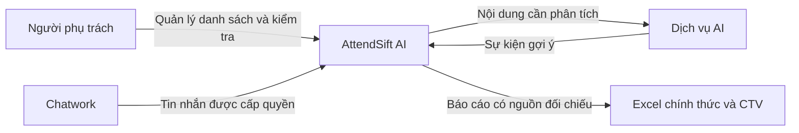
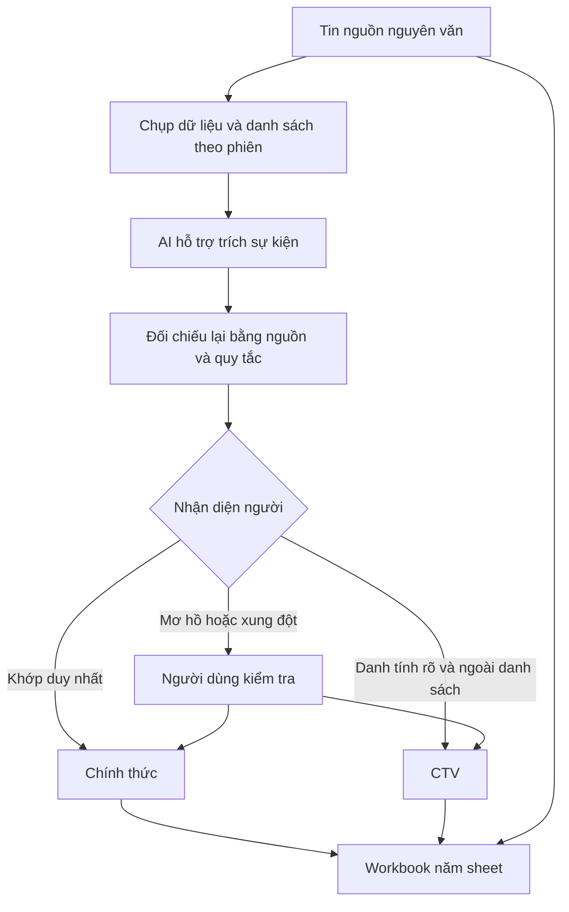

# Kiến trúc AttendSift AI 1.1.0

## Nhìn từ công việc của con người

Một báo cáo tốt cần trả lời được: ai, ngày nào, thời lượng bao nhiêu, thuộc nhóm nào và có tin nào làm căn cứ. Vì vậy ranh giới quan trọng nhất trong thiết kế là giữa tin nguồn, kết quả suy ra và quyết định đã xác nhận.

Sơ đồ ngữ cảnh dưới đây mượn cách tiếp cận của [C4 System Context](https://c4model.com/diagrams/system-context): bắt đầu bằng người dùng và hệ thống liên quan, chưa đưa chi tiết mã nguồn vào cùng một hình.

Chatwork và nhà cung cấp AI là phụ thuộc bên ngoài. Ứng dụng không kiểm soát hạn mức, thời gian phản hồi hay độ đầy đủ lịch sử do các dịch vụ này cung cấp.

## Từ một tin nhắn đến một dòng báo cáo

Nghỉ nguyên ngày/nửa ngày được xác định theo từng ngày nêu trong câu. Không dùng ngày gửi để thay ngày sự kiện. Không suy ra loại phép hoặc tiền lương chỉ từ thời lượng.

## Hai cách triển khai

| Thành phần | Local Windows | Cloud |
|---|---|---|
| Giao diện | WebView2 hoặc trình duyệt loopback | Trình duyệt, xác thực quản trị |
| Điều phối | src/app/server.py | cloud/app.py |
| Lưu trữ | SQLite cạnh ứng dụng | PostgreSQL qua cloud/repository.py |
| Danh sách | Khóa employee_registry_v1 trong settings | Cùng định dạng trong cc_settings |
| Phiên | ai_settings lưu bản chụp danh sách | ai_settings JSONB lưu bản chụp danh sách |
| Tự động | Windows Task Scheduler | Vercel Cron |

Không có đồng bộ danh sách hoặc dữ liệu ngầm giữa hai bản. Nhập danh sách cho từng nơi giúp rõ quyền và nguồn dữ liệu, đổi lại cần quy trình quản trị để tránh chênh lệch.

## Ranh giới mô-đun

| Mô-đun | Trách nhiệm | Không tự quyết định |
|---|---|---|
| employee_registry.py | CRUD, tên thường dùng, phiên bản danh sách, khởi tạo riêng | Không phán đoán quan hệ lao động |
| personnel_policy.py | Phân loại và thời lượng nghỉ có căn cứ | Không tự tính lương |
| source_reconciliation.py | Đối chiếu sự kiện với nội dung nguồn | Không thay tin nhắn gốc |
| validation.py | Chặn dữ liệu chưa hợp lệ | Không dùng confidence để bỏ qua lỗi |
| export_service.py / cloud/app.py | Điều phối theo phiên, rà soát, trạng thái | Không tự sửa báo cáo lịch sử khi đổi danh sách |
| personnel_excel.py | Bảng CTV và tổng nghỉ chung | Không cộng OT CTV vào chính thức |

Đây là ứng dụng triển khai theo mô-đun trong một khối cho mỗi chế độ. Các phần cũ còn gọi trực tiếp repository và lớp xác thực; chưa phải hệ thống có ranh giới mô-đun được cưỡng chế hoàn toàn bằng công cụ.

## Quyết định và đánh đổi

| Lựa chọn giữ lại | Có lợi gì | Đổi lại điều gì | Cách giảm nhược điểm |
|---|---|---|---|
| Quy tắc dùng chung | Giảm lệch Local/Cloud | Hai bộ điều phối vẫn có thể khác nhau | Kiểm thử cùng tình huống trên hai luồng |
| Danh sách trong settings có phiên bản | Nâng cấp không phải thay cấu trúc bảng cũ | Cập nhật cả danh sách; chưa tối ưu quy mô lớn | Khóa thao tác, giới hạn dữ liệu; chuyển bảng riêng khi cần |
| Bản chụp theo phiên | Báo cáo cũ có thể giải thích lại | Tăng dữ liệu lưu | Retention cloud, hướng dẫn lưu báo cáo |
| Người ngoài danh sách là CTV | Thuận quy trình người dùng yêu cầu | Thiếu danh sách có thể phân loại sai | Cảnh báo danh sách trống, tên mơ hồ cần kiểm tra |
| Ngừng hoạt động thay xóa vật lý | Giữ liên kết lịch sử | Còn lưu hồ sơ cũ | Hiển thị trạng thái và quản trị quyền truy cập |
| Workbook năm sheet | Kiểm tra cùng một file | Người dùng cần hiểu sự khác nhau giữa các sheet | Nhãn rõ, hướng dẫn, ví dụ tổng tách biệt |

## Điểm kiểm soát dữ liệu

- Khóa và quyền HTTP áp dụng cả API nhân viên.
- Tên chính thức, tên trong nguồn và căn cứ phân loại được lưu riêng.
- Nhập lại danh sách không ghi đè chỉnh sửa hoặc kích hoạt lại người đã ngừng.
- Danh sách thật không đi vào Git công khai. File khởi tạo nội bộ được tách khỏi nguồn.
- Cron 3 tháng không xóa khóa danh sách nhân viên.
- Phiên cũ vẫn đọc theo chính sách cũ; muốn kết quả mới phải tạo phiên mới.
- Nội dung nguồn ghi dạng text trong Excel để tránh bị hiểu thành công thức.

## Khi nào nên thay đổi thiết kế?

Tách danh sách thành bảng quan hệ khi cần tìm kiếm/phân quyền hoặc cập nhật đồng thời ở quy mô lớn. Tách tác vụ phân tích thành hàng đợi khi có đo lường cho thấy request dài gây gián đoạn. Chỉ cân nhắc dịch vụ độc lập khi có nhu cầu vận hành hoặc mở rộng riêng được chứng minh.

Đây là hướng phát triển, không phải tính năng đã được triển khai. Xem [đánh giá nguồn và lựa chọn](ARCHITECTURE_REVIEW_1.1.0.md) và [bằng chứng kiểm thử](VERIFICATION_1.1.0.md).
