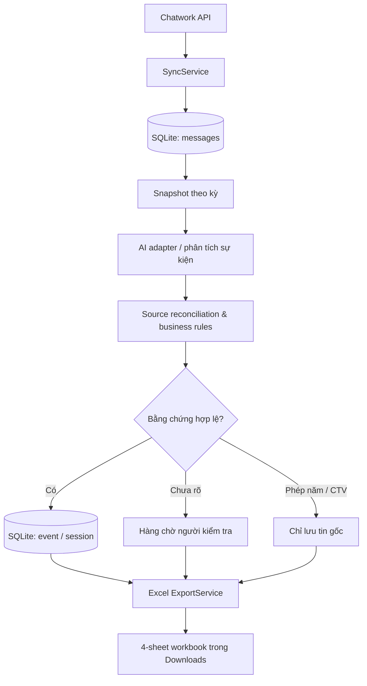

# Kiến trúc và luồng dữ liệu

## Thành phần đã xác nhận từ mã nguồn

**Các thành phần chính:** `src/app/server.py` tạo Flask API loopback và kiểm tra CSRF; `src/services/sync_service.py` đồng bộ; `src/models/database.py` quản lý SQLite; `src/adapters/` giao tiếp Chatwork/AI; `src/services/source_reconciliation.py` và `event_policy.py` đối chiếu nguồn; `src/services/export_service.py` xuất theo phiên; `src/utils/excel_export.py` tạo workbook.

## Quyết định kỹ thuật

| Quyết định | Lợi ích | Giới hạn/trade-off |
|---|---|---|
| SQLite trên máy Local | Không cần Postgres hay mạng nội bộ để xem lịch sử | Mỗi máy lưu dữ liệu riêng, không đồng bộ thời gian thực |
| Chỉ bind `127.0.0.1` | Không tự mở API ra LAN/Internet | Chỉ dùng ở chính máy đang chạy |
| Lưu `Source ID` | Truy xuất bằng chứng, đối chiếu kết quả AI | Cần quản lý các tin đã sửa/xóa và chất lượng nguồn |
| Snapshot theo phiên | Tạo bản ghi nhất quán cho kỳ xuất | Phân tích lại có thể tạo phiên mới và cần kiểm tra kết quả |
| Xuất Excel 4 sheet | Phù hợp quy trình kiểm tra bằng bảng tính | Phải kiểm chứng trên Microsoft Excel/WPS thật |
| Chính sách nghiệp vụ riêng | CTV, phép năm và OT nhóm dễ kiểm thử | Không phải quy tắc pháp lý hay chính sách của mọi doanh nghiệp |

## Đảm bảo/chưa đảm bảo

- **Có trong mã:** kiểm tra Host/Origin, CSRF cho mutation, giới hạn file upload, log xoay vòng, bộ kiểm thử chính sách.
- **Chưa chứng nhận:** an toàn tuyệt đối khi lộ cổng, độ chính xác AI, tái nhập dữ liệu mọi tình huống, phân quyền nhiều người, năng lực tải lớn, chạy Windows với API thật.
- `cloud/` là một chế độ khác; muốn dùng chung dữ liệu đa máy phải triển khai cơ sở dữ liệu tập trung và kiểm tra bảo mật độc lập.

## Cloud trong b?n 1.0.2

`cloud/app.py` ph?c v? HTTP c? x?c th?c; `cloud/repository.py` l?u PostgreSQL tr?n Neon. Cron h?p l? ch?y d?n d? li?u 3 th?ng tr??c khi ??ng b?. `cloud/retention.py` t?nh cutoff theo th?ng l?ch v? GMT+7. File Excel l?u trong `cc_files`, snapshot/k?t qu? trong `cc_sessions`; d?n file tr??c phi?n ?? gi? quan h? kh?a ngo?i.

Giao d?ch d?n kh?a c?c b?ng li?n quan trong th?i gian ng?n, ??t lock timeout 5 gi?y v? ho?n phi?n ?ang c? lease x? l?. Khi l?i, giao d?ch rollback. ??ng b? b? qua tin g?i tr??c cutoff ?? kh?ng nh?p l?i d? li?u h?t h?n. Kh?a/c?u h?nh trong `cc_settings` kh?ng b? d?n.

`cloud/static/cloud.js` v? `public/static/cloud.js` c?n c?ng n?i dung. Formatter th?i gian ch? thay ??i c?ch hi?n th?; b?n tin ngu?n trong database v?n gi? timestamp c? m?i gi?. Xem [v?n h?nh cloud](CLOUD_OPERATIONS.md).
